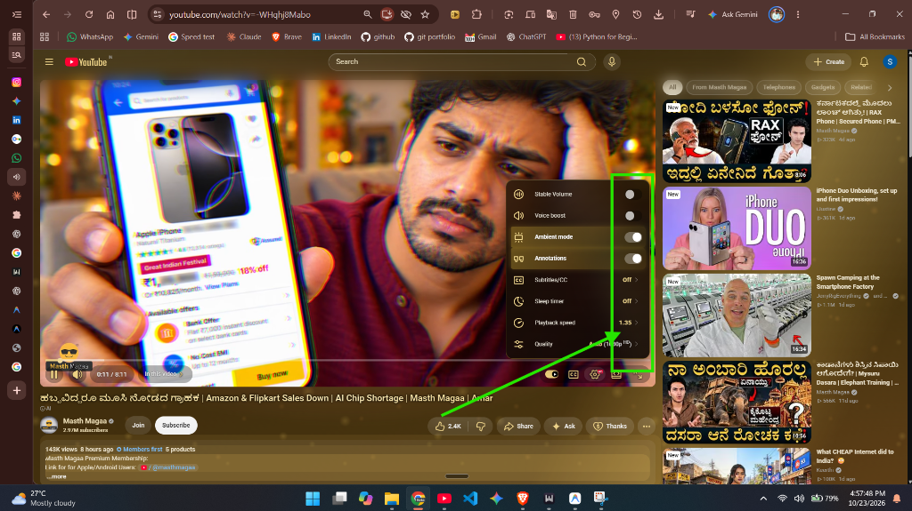
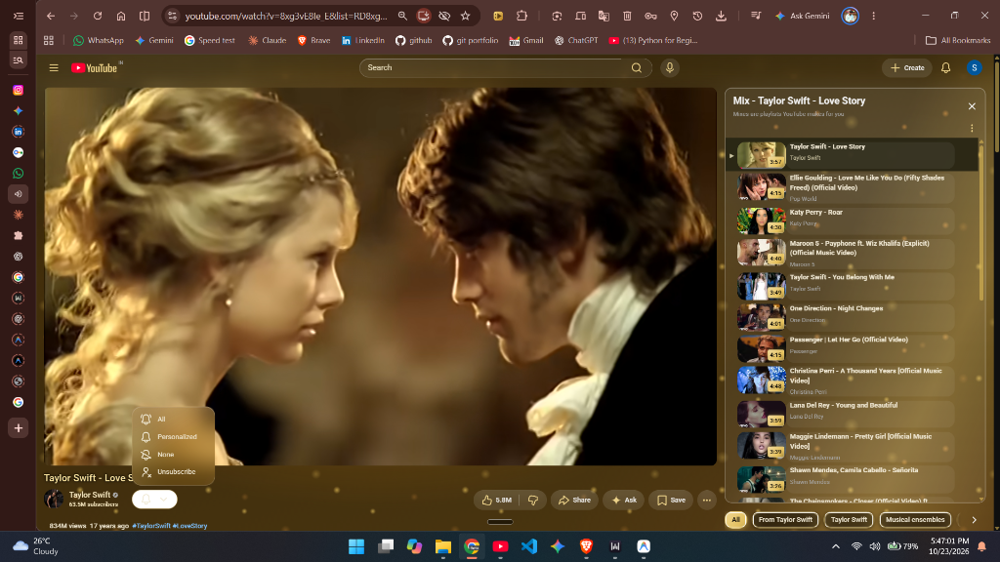
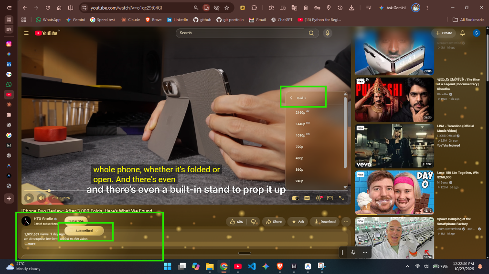

# ✨ Gold Glass 2.0 — Premium Transparent Glass UI & Dynamic Theme Studio

[](https://developer.chrome.com/docs/extensions/mv3/intro/)
[](manifest.json)
[](https://www.google.com/chrome/)
[](LICENSE)

> **Gold Glass 2.0**: A futuristic, liquid-glass visual theme and enhancement suite. Experience seamless translucent glassmorphism, dynamic 3D theme carousels, cinematic GPU-accelerated ambient animations, scenic wallpaper integration, and real-time studio customization.

---

## 🌟 What's New in Gold Glass 2.0

### 🎨 Master Studio Dashboard (`options.html`)
- **16:9 Landscape Composition**: Full-page interactive command center featuring a floating dark-glass window, responsive navigation rail, 3D theme carousel over an alpine sunset landscape, and real-time previews.
- **Dynamic 3D Theme Carousel**: Smooth horizontal wheel, trackpad, and keyboard arrow navigation with active glowing gold borders and depth scaling.
- **Curated Palette**: Deep espresso (`#171006`), transparent dark glass (`rgba(24, 17, 8, 0.22)`), royal gold (`#F4C542`), champagne gold (`#E8C878`), soft ivory (`#FFF5D9`), and muted bronze (`#76551A`).

### 🧊 3 Transparent Modes
- **Normal Glass**: Lightly tinted glass with readable content and visible scenery.
- **High Transparency**: Clearer panels with stronger backdrop visibility and lighter shadows.
- **Ultra Clear**: Minimal background tint, subtle borders, and near-invisible floating glass surfaces.

### 🎬 Dedicated Animation Studio
- **Firefly**: Tiny golden particles drifting slowly through the background with a soft natural glow.
- **Waver**: Smooth, flowing gold ribbons and light waves gliding gently behind the interface.
- **Aurora**: Soft shifting celestial bands of teal, green, and violet light.
- **Stars**: Twinkling starfield with gradual cosmic drift.
- **Embers**: Warm orange-gold sparks rising organically.

### 🖼️ Scenic Wallpaper Gallery
- Instant scenic presets: **Default** (Sunset Alps), **Nature** (Alpine Valley), **City** (Sunset Skyline), **Space** (Cosmic Nebula), **Ocean** (Deep Azure), and **Forest** (Boreal Mist), plus custom photo upload.

---

## 📸 Screenshots

### 🌟 Home Feed with Transparent Glass & Royal Gold Accents


### 🎬 Video Watch Page & Frosted Glass Player


### 💎 Liquid Frosted Glass Panels & Topic Pills


---

## 🚀 Key Features

### 🧊 Liquid Frosted Glass Interface
- **Dynamic Glass Transparency**: Smooth `-webkit-backdrop-filter` and liquid blur across header masthead, sidebar guides, comment sections, and video descriptions.
- **Natural Light Refraction**: Subtly tinted glass edges that highlight your active wallpaper without interfering with video clarity or text readability.

### 🎨 12 Handcrafted Royal Themes
Seamlessly switch between 12 distinct multi-hue palettes:
- **Royal Gold**: Deep imperial gold with gleaming honey undertones.
- **Noir Gold**: Midnight obsidian base with gilded amber embers.
- **Sapphire**: Deep ocean blues with tidal cyan reflections.
- **Amethyst**: Majestic cosmic purple with nebula pink tones.
- **Emerald**: Lush jade green with glade forest highlights.
- **Crimson**: Velvet rose with ruby-silk gradients.
- **Silver**: Polished moonlit chrome with subtle slate sheen.
- **Northern**: Arctic boreal green with aurora violet transitions.
- **Sunset**: Dusk violet with rich sunburst orange horizons.
- **Deep Sea**: Oceanic turquoise with aquatic wave drifts.
- **Rose Quartz**: Soft sakura pink with champagne highlights.
- **Galaxy**: Deep interstellar violet with starry nebulae.

### 🌌 5 Live Ambient Animations (GPU Accelerated)
Selectable from the extension popup with live thumbnail previews:
1. **Firefly**: Organic glowing embers swaying softly across the background.
2. **Waver**: Gentle wave-form silk bands gliding across the viewport.
3. **Aurora**: Sweeping celestial ribbons of shifting light.
4. **Stars**: Sparkling, drifting stars with multi-layered twinkling.
5. **Embers**: Warm sparks rising gracefully from the bottom.
- **Variable Animation Speed**: Easily toggle from **0.5x** to **3.0x** or pause while scrolling.

### 🎯 Refined Interface Polish
- **Pill-Shaped Topic Chips**: Fully redesigned pill chips with smooth borders. Active topics illuminate with vibrant theme-specific gold/accent gradients—never pitch black.
- **Distraction-Free Video Menus**: Clean, transparent liquid frosted glass dropdown menus. Removed preselected shimmers—menu items highlight elegantly only when your cursor hovers over them.
- **Precise Link Styling**: External links in descriptions and comments stand out in crisp blue (`#7cc0ff`), while timestamps and chapter markers comfortably match the theme typography.
- **Custom Wallpaper Upload**: Set any personal photo or high-res image as your YouTube background with optional subtle Ken Burns slow zoom and blur adjustments.
- **Sponsor & Ad Controls**: Built-in support for auto-skipping video ads and sponsor segments.

---

## 📥 Installation Guide

### Option 1: Load as Unpacked Extension (Recommended)
1. **Clone or Download** this repository:
   ```bash
   git clone https://github.com/Sanjeevkumarmd/Transparent-YouTube.git
   ```
   *(Or download and extract the ZIP archive from GitHub).*
2. Open your Chromium-based browser (Google Chrome, Microsoft Edge, Brave, Opera, Vivaldi).
3. Navigate to `chrome://extensions/` (or `edge://extensions/`).
4. Toggle on **Developer mode** in the top-right corner.
5. Click **Load unpacked** and select the cloned `Transparent-YouTube` folder (containing `manifest.json`).
6. Open [YouTube](https://www.youtube.com/) and enjoy the new transparent experience!

---

## 🎛️ How to Use

1. Click the **YT Gold Glass** extension icon in your browser toolbar.
2. **Themes Carousel**: Use the large `❮` and `❯` arrow buttons to browse through themes. Click any theme card to activate it immediately.
3. **Animation Wheel**: Choose your preferred background animation with real-time live previews.
4. **Speed Selector**: Pick your desired speed from `0.5x` up to `3.0x`.
5. **Customize Panel**: Click `⚙ Customize` to access advanced developer options (glass fill opacity, wallpaper dimming, photo blur, ambient glow strength, and more).

---

## 🛠️ Built With

- **Manifest V3** - Modern Chrome Extension Architecture
- **Vanilla JavaScript** - High performance, zero dependencies
- **Modern CSS3** - Hardware-accelerated transforms, CSS Variables (`var(--ytg-*)`), `-webkit-backdrop-filter`

---

## 📄 License

This project is licensed under the [MIT License](LICENSE).
